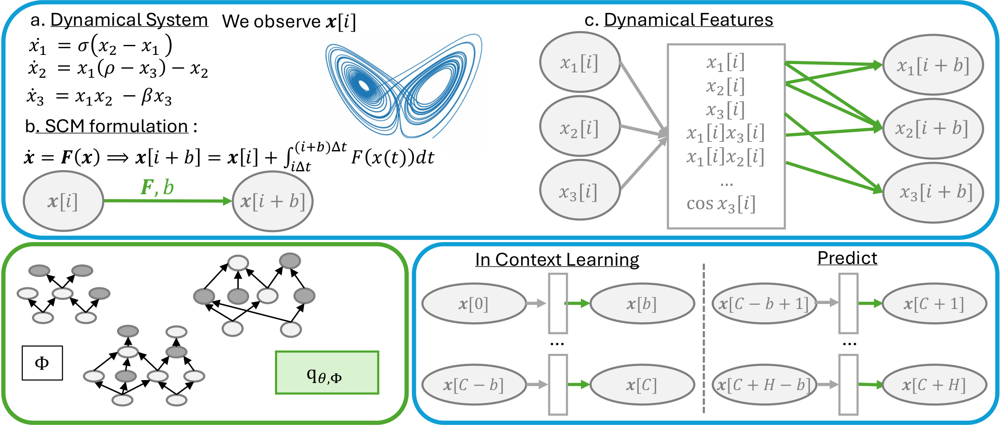

# DynaPFN: Zero-Shot Dynamical System Forecasting with Tabular Prior-Fitted Networks

Official code for **DynaPFN** (NeurIPS 2026).

Chiara Roverato, Joseph Cotnareanu, Pablo Piantanida, Boris N. Oreshkin, Mark Coates



DynaPFN frames dynamical time-series forecasting as posterior inference over structural causal models.
The context of a time series is rewritten as a set of lagged input-output pairs $(\mathbf{x}[i], \mathbf{x}[i+b])$,
augmented with a SINDy-inspired library of dynamical features $\mathbf{G}$ (polynomials up to a given degree, sines and cosines).
A pretrained tabular PFN (TabPFN by default) then learns the lag-$b$ transition map in context, without any training on time series,
and the horizon is predicted autoregressively, $b$ timesteps at a time.

## Repository structure

| File | Description |
|---|---|
| `main.py` | Runs DynaPFN (function `dynapfn()`) on the chaotic benchmark |
| `compute_metrics.py` | Computes the evaluation metrics from the saved predictions |
| `metrics.py` | Metric implementations ($D_\text{stsp}$, Hellinger distance, MSE, MAE, SMAPE, Lyapunov exponent, ...) |
| `generate_data.py` | Generates the chaotic benchmark trajectories with [dysts](https://github.com/williamgilpin/dysts) |
| `utils.py` | Feature library, data reshaping and plotting helpers |
| `src/` | Bundled versions of [TabPFN](https://github.com/PriorLabs/TabPFN) and [TabICL](https://github.com/soda-inria/tabicl) |

## Requirements

Python 3.10 or newer is required (`dysts` 0.96 does not support older versions). Install the dependencies with

```bash
pip install -r requirements.txt
```

A GPU is recommended. TabPFN and TabICL use CUDA automatically when it is available.

## Data format

Each dynamical system is stored as two NumPy files in a single folder:

| File | Shape | Content |
|---|---|---|
| `{equation}.npy` | `(n_series, n_points, D)` | `n_series` trajectories (one per initial condition) of a `D`-dimensional system |
| `{equation}_t.npy` | `(n_series, n_points)` | Physical time of each point |

`{equation}` is the system name (e.g. `Lorenz.npy`, `Lorenz_t.npy`).
The first `C` points of each trajectory are used as context (`--context_length`, default 1024) and the remaining
`n_points - C` points are the forecast horizon.

The paper's benchmark uses 54 chaotic systems from dysts, with `n_series = 20` initial conditions,
`n_points = 10000` and 30 points per Lyapunov time (context $C = 1024$, horizon $H = 8976$).
To regenerate it:

```bash
python generate_data.py
```

This writes the files to `chaotic_benchmark/` (change with `--output_dir`), skipping systems already generated.
Options: `--n_series`, `--n_points`, `--pts_per_period`, `--equations`, `--n_jobs`.
Any other dataset can be used as long as it follows the same format.

## Usage

### 1. Forecast

```bash
python main.py \
    --trajectories_dir chaotic_benchmark \
    --output_dir results
```

Main options:

| Argument | Default | Description |
|---|---|---|
| `--model` | `TabPFN` | Backbone: `TabPFN`, `TabICL`, `TabICL-modified` or `CatBoost` |
| `--b` | `5` | One or more block sizes $b$ |
| `--context_length` | `1024` | Context length $C$ |
| `--equations` | all 54 systems | Subset of systems to run, e.g. `--equations Lorenz Chua` |
| `--polynomial_degree` | `4` | Maximum degree of the polynomial features in $\mathbf{G}$ (0 disables the library) |
| `--refit` | off | Refit the PFN on the extended context after each predicted block |
| `--true_features` | off | Compute the features from the true values instead of the predictions (true-features experiment, RQ2) |
| `--no_timestamp` | off | Drop the timestamp input feature (kept by default) |

For each system and block size, `main.py` writes, with `output_path = {output_dir}/{equation}_b{b}`:

- `{output_path}_y_val.npy`: ground truth, shape `(n_series * H, D)`
- `{output_path}_y_val_pred.npy`: forecast, shape `(n_series * H, D)`
- `{output_path}_pred_vs_actual_dim{d}.png`: plot of the forecast for each dimension

You can also call the forecaster from Python:

```python
from main import dynapfn

dynapfn(data=(tsdfs_forecast, tsdfs_train), model_name="TabPFN",
        output_path="results/Lorenz_b5", block_size=5)
```

where `tsdfs_train` and `tsdfs_forecast` are built from the arrays above with `utils.make_df_per_dimension`
(see the end of `main.py`).

### 2. Evaluate

```bash
python compute_metrics.py \
    --trajectory chaotic_benchmark/Lorenz.npy \
    --predictions results/Lorenz_b5_y_val_pred.npy \
    --output metrics/TabPFN_b5_Lorenz.npy
```

`--trajectory` is the ground-truth file (the matching `{equation}_t.npy` must be in the same folder)
and `--predictions` is any predicted trajectory of shape `(n_series * H, D)`, e.g. one written by `main.py` or a baseline.

## Citation

If you use this code, please cite:

```bibtex
@inproceedings{roverato2026dynapfn,
  title     = {DynaPFN: Zero-Shot Dynamical System Forecasting with Tabular Prior-Fitted Networks},
  author    = {Roverato, Chiara and Cotnareanu, Joseph and Piantanida, Pablo and Oreshkin, Boris N. and Coates, Mark},
  booktitle = {Advances in Neural Information Processing Systems},
  year      = {2026}
}
```

## Acknowledgements

This repository bundles code from [TabPFN](https://github.com/PriorLabs/TabPFN) (Prior Labs)
and [TabICL](https://github.com/soda-inria/tabicl) (INRIA), and uses [dysts](https://github.com/williamgilpin/dysts)
for the chaotic systems benchmark. Please also cite these works.
The bundled copies in `src/` keep their original licenses: Apache-2.0 for TabPFN and BSD-3-Clause for TabICL
(see [`src/README.md`](src/README.md)).

## License

This code is released under the [MIT License](LICENSE), except for the third-party code in `src/`,
which keeps its original licenses (see [`src/README.md`](src/README.md)).
